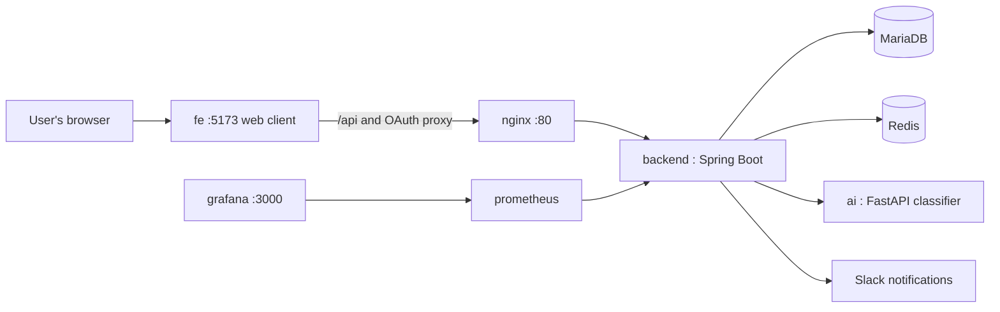
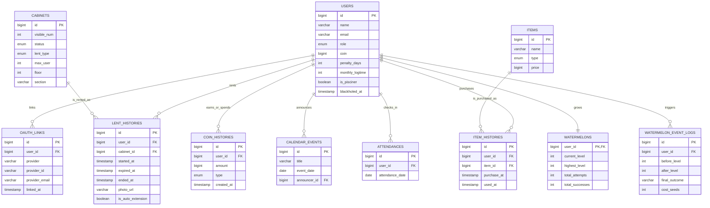

*This project has been created as part of the 42 curriculum by juyoukim, seonghan, byoulee, taewonki.*

# Subak (수박) — Campus Locker Management System

## Description

Subak is a full-stack web application that manages locker rental and return for the 42 Gyeongsan campus. Users sign in with 42, Kakao, or Google OAuth to browse, rent, return, and reserve lockers, while admins manage locker status and user accounts from a dedicated dashboard. When a user returns a locker, the photo they upload is automatically checked by a separate AI image-classification server to confirm the locker is actually empty before the return is finalized.

The live service is available at **[https://subak.site](https://subak.site)**. Features that require authentication (renting, returning, reserving, the coin store, the attendance check-in, etc.) are best explored there; the local setup below is intended for building, booting the stack, and exercising the public API.

The project is split into three services:

- **backend** — the API server responsible for rental/return workflows, OAuth authentication, the coin wallet and store, Slack notifications, and admin statistics.
- **ai** — an image-classification server (EfficientNetV2-S) that decides whether a returned locker is actually empty from the uploaded photo.
- **fe** — the React + TypeScript web client: locker browsing, rental/return/reservation, "my locker," the coin store, attendance, a watermelon gamification event, and the admin screens.

### Key features

- Secure sign-in via 42, Kakao, and Google OAuth 2.0 (no local password accounts)
- Locker browsing, rental, return, and reservation with a shared reservation calendar
- AI-assisted return verification from a photo, backed by a dedicated microservice
- A coin wallet, item store, and a "watermelon" gamification event with levels and a leaderboard
- Daily attendance check-in that rewards users with coins
- Slack notifications for rental/return/overdue events, driven by a Redis stream
- An admin dashboard for user, locker, and ban management with usage statistics
- Prometheus/Grafana monitoring and a Swagger-documented public API

## Instructions

### Prerequisites

| Component | Version |
|---|---|
| Java | 17 |
| Node.js (only needed to develop/build the FE on the host) | 22+ |
| React / TypeScript / Vite (fe) | 19 / 5.9 / 5 |
| Spring Boot (backend) | 3.5.8 |
| Spring Boot (ai/webapp test harness) | 3.2.0 |
| Python | 3.11 |
| FastAPI | 0.115.6 |
| PyTorch | 2.2.2 |
| MariaDB | 10.6 |
| Redis | alpine (latest) |
| Docker / Docker Compose | latest stable |

`make up` builds the FE inside a Node.js 22 Docker image, so Node.js is not required on the host for that path. The FE dev server (`make fe`) and a host build (`make build`) do require Node.js 22+ and npm. Running everything without Docker additionally requires installing Java 17, Python 3.11, MariaDB, and Redis yourself. See [fe/README.md](fe/README.md) for FE-specific setup.

### Running the project

```bash
git clone https://github.com/42gyeongsan-hackathon-2026/42.Zip-team12.git
cd 42.Zip-team12
make env      # generate root .env and fe/.env (existing files are kept)
make up       # build backend, build FE, start the full container stack
make seed     # seed 304 lockers (no user data)
make check    # call a status API as a smoke test
make check-fe # verify the FE screen and the FE proxy to the public API
```

Open **http://localhost:5173** in a browser. FE requests to `/api/v4/*` are proxied through Nginx to the local backend's `/v4/*`. Routes such as `/lockers` can also be opened or refreshed directly.

To develop against the FE while the rest of the stack is running, stop the FE container first (it shares port 5173 with the dev server) and start the dev server:

```bash
docker compose stop fe
make fe       # npm ci, then the Vite dev server on http://localhost:5173
```

`make fe` only starts the FE dev server, so the backend must already be running to exercise the public API. If the backend is running on the host via `make run` (port 8080), point the dev server at it from another terminal with `FE_API_TARGET=http://localhost:8080 make fe`. The default proxy target is `http://localhost`.

Key `make` targets:

| Command | Description |
|---|---|
| `make build` | Build the backend JAR and type-check/build the FE for production |
| `make build-fe` | Install FE dependencies (`npm ci`) and type-check/build |
| `make logs-fe` | Tail the FE container logs |
| `make down` | Stop every container, including FE, keeping data |

For running services without `make`, running locally without containers, or per-service configuration, see each folder's README:

- Backend: [backend/README.md](backend/README.md)
- AI service: [ai/README.md](ai/README.md) (based on [42-Gy/ft_cabinet_AI](https://github.com/42-Gy/ft_cabinet_AI))
- Frontend: [fe/README.md](fe/README.md)

### Environment variables

```bash
cp .env.example .env
cp fe/.env.example fe/.env
```

`make env` generates both files as well. Values in `.env.example` are placeholders; real values belong in the git-ignored `.env`. Required variables include DB credentials, the JWT secret, 42/Kakao/Google OAuth client credentials, the Slack bot token, the Azure Blob Storage connection string, and the AI model path (`AI_MODEL_PATH`). Lines starting with `#` are optional and already show their default. See the comments in `.env.example` and [backend/README.md](backend/README.md) for details on each variable.

The FE dev server reads `fe/.env`. By default it uses the local API with `VITE_API_BASE_URL=/api` and `VITE_USE_MOCK=false`. `VITE_*` values end up in the browser bundle, so secrets never go there. The FE container is built from `fe/.env.example`; a personal `fe/.env` is never baked into the Docker image. See [fe/README.md](fe/README.md) for the full variable list.

Running locally with placeholders left as-is applies these effective values:

- `REDIS_PORT=6379`
- `FRONTEND_URL=http://localhost:5173`
- `COOKIE_SECURE=false`
- `AI_MODEL_PATH=models/efficientnetv2s_3class_traced_v2.0.0.pt`

The default FE origin `http://localhost:5173` is already in the backend's CORS allow-list. If you are reusing an existing `.env`, update `FRONTEND_URL` to that value.

`make up` finishes successfully even with placeholder values for 42/Kakao/Google client credentials, the Slack bot token, and the Azure connection string, but the following features will not work:

| Feature | Works with placeholders? | Reason |
|---|---|---|
| 42 / Kakao / Google login | No | The redirect to the real provider happens, but the fake client ID/secret fails authentication on the provider's side. |
| Slack notifications | No | The token isn't validated at boot, but real Slack API calls fail authentication. |
| Return-photo upload | No | Creating the Azure Blob client doesn't block boot, but the actual upload fails with fake credentials. |

With placeholders in place, only public endpoints such as locker listing/status work; renting, returning, and extending require OAuth login.

The root `docker-compose.yml` does not forward every optional variable to the `backend` service (e.g. `SLACK_NOTICE_*`, `SLACK_REPORT_*`, `GEMINI_API_KEY`, `APP_AUTH_COOKIE_SECURE`) — setting them in `.env` has no effect on containers started with `make up`.

The root `.env.example` matches the local `docker-compose.yml` for demo purposes. `backend/.env.example` documents the production profile (externally managed DB, SSL Redis) and is not used by the local compose setup.

### Accessing and verifying the stack

Once `make up` has started the full stack:

- API: `http://localhost`
- Local frontend: `http://localhost:5173`
- Swagger: `http://localhost/swagger-ui/index.html`
- Grafana: `http://localhost:3000` (admin / admin)
- AI service health: `make check-ai` (only reachable on the internal Docker network, exposed on the host as `127.0.0.1:8000`)
- Locker status summary (no login required): `curl http://localhost/v4/cabinets/status-summary/all` (same call as `make check`)
- Deployed instance: https://subak.site

The only endpoints usable without logging in are `GET /v4/cabinets`, `GET /v4/cabinets/{id}`, `GET /v4/cabinets/status-summary`, `GET /v4/cabinets/status-summary/all`, and Swagger. Every other `/v4/**` endpoint requires 42/Kakao/Google OAuth login, and `/v4/admin/**` plus `/actuator/**` require the ADMIN role.

Login only works through 42/Kakao/Google OAuth; no test accounts are provided, and the seed data contains only lockers, not accounts.

To log in locally, register real OAuth client credentials and set each provider's redirect URI to `{FRONTEND_URL}/login/oauth2/code/{42|kakao|google}` (by default `http://localhost:5173/login/oauth2/code/42`, etc.). Compose and `make run` override the backend's OAuth redirect URI to this address. The FE proxies `/oauth2/*` and `/login/oauth2/*` to the backend. Login fails if `FRONTEND_URL` doesn't match the registered redirect URI exactly.

### Folder structure

| Folder | Content |
|---|---|
| `backend/` | API server (Spring Boot) |
| `ai/` | Image classification server (FastAPI + PyTorch), including a test webapp |
| `fe/` | Web frontend (React + TypeScript + Vite), with Docker/Nginx configuration |

### Architecture



## Team Information

| Member | Role(s) | Responsibilities |
|---|---|---|
| **juyoukim** | Technical Lead, Backend & Infrastructure Developer | Backend architecture, API design, database integration, OAuth/auth logic, Docker/Nginx deployment, monitoring setup |
| **seonghan** | Project Manager, Frontend Developer, AI Developer | Sprint planning and scheduling, frontend feature screens, the AI return-verification model and service |
| **byoulee** | Project Manager, Frontend Developer | Task tracking and scheduling, frontend feature screens, UI consistency |
| **taewonki** | Documentation / QA | Documentation upkeep, issue tracking, release validation |

## Project Management

The team split work along backend/infrastructure, frontend, AI, and documentation lines, with the two frontend developers sharing project-management duties (scheduling, task tracking, and keeping the team unblocked).

- **Task & schedule tracking**: Notion, used for planning boards, decisions, and documentation drafts
- **Day-to-day communication**: Slack, for async updates and quick questions
- **Meetings**: Discord, for voice stand-ups and pairing sessions
- **Code review**: Git/GitHub, through feature branches and pull requests
- **Delivery model**: backend, frontend, and AI work proceeded in parallel and were integrated through shared API contracts, with documentation kept up to date alongside implementation

## Technical Stack

### Frontend

- React 19, TypeScript, Vite
- Feature-sliced structure (`features/`, `components/atoms|molecules|organisms|templates`)

**Why this choice:** React's component model keeps a growing number of screens (lockers, calendar, store, attendance, admin) organized, TypeScript catches integration errors against the backend's API contracts early, and Vite keeps local iteration fast.

### Backend

- Java 17, Spring Boot 3.5.8, a hexagonal (ports & adapters) package structure
- Spring Data JPA, Spring Security, Resilience4j (rate limiting), springdoc-openapi (Swagger UI)
- Redis for caching, distributed locks (ShedLock), and a Pub/Sub stream that drives Slack notifications

**Why this choice:** Spring Boot's ecosystem covers authentication, validation, scheduling, and rate limiting out of the box, and the hexagonal structure keeps domain logic (lockers, rentals, coins, the watermelon event) independent from persistence and web adapters as the feature set grew.

### AI service

- Python 3.11, FastAPI, PyTorch, an EfficientNetV2-S image classifier

**Why this choice:** Running the classifier as its own FastAPI service keeps the heavier ML runtime isolated from the main API server, so it can be scaled, updated, or swapped independently.

### Database and cache

- MariaDB 10.6
- Redis

**Why this choice:** MariaDB models users, lockers, coin/item history, and the watermelon event with clear relational constraints; Redis provides fast caching, distributed locking for concurrent rentals, and the stream backing the notification pipeline.

### Infrastructure and tooling

- Docker / Docker Compose, Nginx, a Makefile for local automation
- Prometheus + Grafana for monitoring

**Why this choice:** Docker Compose gives the whole stack (DB, cache, AI service, backend, FE, reverse proxy) a single-command local setup, Nginx routes the FE, API, and OAuth callbacks consistently, and Prometheus/Grafana give visibility into the running service.

## Database Schema



### Core tables

- `users`: identity, OAuth-linked role, coin balance, and 42-campus metadata (penalty days, blackhole status)
- `oauth_links`: 42/Kakao/Google provider links per user
- `cabinets`: locker metadata, status, and position
- `lent_histories`: rental/return records, including the uploaded return photo
- `coin_histories`: ledger of coin earnings (attendance, watermelon event) and spending (store, admin grants)
- `items` / `item_histories`: the store catalog and each user's purchases
- `calendar_events`: reservation/announcement calendar entries
- `attendances`: daily check-in records
- `watermelons` / `watermelon_event_logs`: per-user gamification state and the history of each level-up attempt

## Features List

| Feature | Description | Team member(s) |
|---|---|---|
| OAuth login | Sign-up/sign-in via 42, Kakao, or Google, with role-based access | juyoukim |
| Locker browsing & status | Public locker listing and live status summary | juyoukim, byoulee |
| Rental, return & reservation | Rent/return lockers, extend rentals, reserve via a shared calendar | juyoukim, seonghan, byoulee |
| AI-assisted return verification | A photo taken on return is checked by a dedicated classifier before the return is accepted | seonghan |
| Coin wallet & store | Earn coins through attendance/events and spend them on store items | juyoukim, byoulee |
| Attendance check-in | Daily check-in rewarded with coins, tracked in admin statistics | juyoukim, seonghan |
| Watermelon gamification event | A level-up mini-game with protections/fertilizers, backed by a leaderboard | juyoukim, seonghan |
| Admin dashboard | User, locker, and ban management with usage statistics | juyoukim, byoulee |
| Slack notifications | Rental/return/overdue events pushed to Slack via a Redis stream | juyoukim |
| Monitoring | Backend metrics visualized through Prometheus and Grafana dashboards | juyoukim |
| Public API | Swagger-documented REST API, authenticated and rate-limited | juyoukim |

## Modules

| Module | Type | Points | Justification | Implementation | Team member(s) |
|---|---|---|---|---|---|
| Framework for both frontend and backend | Major | 2 | Clean separation between the UI and the API/domain logic | React + TypeScript frontend, Spring Boot backend | juyoukim, seonghan, byoulee |
| Advanced permissions system | Major | 2 | Admin-only actions (user/locker/ban management) need to be isolated from regular users | Role-based Spring Security rules, an admin dashboard restricted to the `ADMIN` role | juyoukim, byoulee |
| Public API with security and validation | Major | 2 | The locker/rental/store domain is exposed as a documented, protected API | Spring Security-protected REST endpoints, Resilience4j rate limiting, springdoc/Swagger documentation | juyoukim |
| Monitoring system (Prometheus + Grafana) | Major | 2 | A service handling real rentals needs visibility into health and load | Prometheus metrics scraping and Grafana dashboards wired into the Compose stack | juyoukim |
| Custom module: AI-based return verification | Major | 2 | Deciding automatically whether a locker photo shows it empty is a non-trivial ML problem, solved by a dedicated, independently deployed microservice rather than a simple rule; it directly gates the return workflow | A separate FastAPI/PyTorch service running an EfficientNetV2-S image classifier, called by the backend during the return flow | seonghan |
| Use an ORM for database access | Minor | 1 | Improves code quality and maintainability | Spring Data JPA entities and repositories | juyoukim |
| Remote authentication with OAuth 2.0 | Minor | 1 | Campus users already have 42/Kakao/Google accounts; a modern, secure external sign-in flow avoids password handling altogether | 42/Kakao/Google OAuth2 login and account linking | juyoukim |
| Notification system | Minor | 1 | Users and admins need to know about rental/return/overdue events without polling the app | Redis Stream events consumed by a Slack bot | juyoukim |
| Gamification system | Minor | 1 | Encourages daily engagement beyond the core rental flow | Watermelon leveling with a leaderboard, daily attendance check-ins, and coin rewards spendable in the store | juyoukim, seonghan |

### Module score

- Major modules: 5 x 2 = 10 points
- Minor modules: 4 x 1 = 4 points
- **Total: 14 points**

## Resources

### Reference material

- Spring Boot Documentation: https://docs.spring.io/spring-boot/
- Spring Security Documentation: https://docs.spring.io/spring-security/
- React Documentation: https://react.dev/
- Vite Documentation: https://vite.dev/
- FastAPI Documentation: https://fastapi.tiangolo.com/
- PyTorch Documentation: https://pytorch.org/docs/
- Redis Documentation: https://redis.io/docs/
- MariaDB Documentation: https://mariadb.com/kb/en/

### AI usage

AI tools were used to support documentation organization and technical research during the project — structuring this README, and looking up library/framework usage while implementing backend and infrastructure features. All AI-assisted output was reviewed and verified by the team before being used.

## Individual Contributions

### juyoukim

- Designed the backend's hexagonal architecture and the API for lockers, rentals, the coin store, the calendar, and admin features
- Implemented 42/Kakao/Google OAuth login and role-based access control
- Built the Redis-backed caching, distributed locking, and the event stream powering Slack notifications
- Set up Docker Compose, Nginx routing, and the Prometheus/Grafana monitoring stack, and integrated the AI service into the return workflow

### seonghan

- Trained and packaged the EfficientNetV2-S image-classification model used to verify returned lockers, and built the FastAPI service that serves it
- Implemented frontend feature screens and contributed to the attendance and watermelon event UI
- Planned sprints and coordinated scheduling as project manager

### byoulee

- Implemented frontend feature screens, including locker browsing/rental, the store, and admin views
- Contributed to UI consistency and shared component structure
- Tracked tasks and coordinated scheduling as project manager

### taewonki

- Maintained project documentation, including setup guides and this README
- Tracked issues and verified release readiness across features
- Supported quality checks and edge-case validation before releases

## Notes

This project focuses on a real operational need of the 42 Gyeongsan campus — locker scarcity and manual return verification — rather than a purely academic exercise, which is why features like AI-assisted return checks, Slack alerts, and admin tooling were prioritized alongside the standard rental flow.
