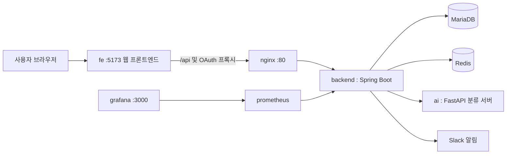

# 수박 (Subak) - 사물함 관리 시스템

## 1. 서비스 소개

42 경산 캠퍼스의 사물함 대여/반납을 관리하는 서비스입니다. 사용자는 42, 카카오, 구글 OAuth 로 로그인해 사물함을 대여하고 반납하며, 관리자는 사물함 상태와 사용자를 관리합니다. 반납 시 올린 사진은 AI 서버가 비어 있는지 판별해 반납 처리를 돕습니다.

실제 서비스는 [https://subak.site](https://subak.site) 에서 이용할 수 있습니다. 로그인이 필요한 기능(대여·반납·예약 등)은 이 사이트에서 체험하는 것을 권장하며, 아래 로컬 실행은 빌드·기동·공개 API 확인 같은 기본 테스트용입니다.

구성은 세 부분으로 나뉩니다.

- **backend**: 대여/반납, 인증, 결제(코인/상점), 알림(슬랙), 통계를 담당하는 API 서버
- **ai**: 반납 사진으로 사물함이 비었는지 판별하는 이미지 분류 서버 (EfficientNetV2-S 기반)
- **fe**: React + TypeScript 사용자 화면. 사물함 조회·대여·반납·예약, 내 사물함, 상점, 출석 및 관리자 화면을 제공합니다.

## 2. 실행 환경 및 필요한 도구·버전

| 구분 | 버전 |
|---|---|
| Java | 17 |
| Node.js (FE를 호스트에서 개발·빌드할 때) | 22 이상 |
| React / TypeScript / Vite (fe) | 19 / 5.9 / 5 |
| Spring Boot (backend) | 3.5.8 |
| Spring Boot (ai/webapp, 테스트용) | 3.2.0 |
| Python | 3.11 |
| FastAPI | 0.115.6 |
| PyTorch | 2.2.2 |
| MariaDB | 10.6 |
| Redis | alpine (latest) |
| Docker / Docker Compose | 최신 안정 버전 |

`make up`은 FE를 Node.js 22 Docker 이미지에서 빌드하므로 호스트에 Node.js가 없어도 됩니다. FE 개발 서버(`make fe`)나 호스트 빌드(`make build`)에는 Node.js 22 이상과 npm이 필요합니다. Docker 없이 실행하려면 Java 17, Python 3.11, MariaDB, Redis도 직접 설치해야 합니다. FE 상세 설정은 [fe/README.md](fe/README.md)를 참고합니다.

## 3. 설치 방법 및 실행 방법

이 저장소는 private 이므로 클론하려면 접근 권한이 필요합니다. Docker/Docker Compose 외에 로컬에 Java 17 이 필요합니다(Gradle Wrapper 로 backend 를 빌드합니다).

```bash
git clone https://github.com/42gyeongsan-hackathon-2026/42.Zip-team12.git
cd 42.Zip-team12
make env     # 루트 .env와 fe/.env 생성 (기존 파일은 유지)
make up      # backend 빌드 → FE 빌드를 포함한 전체 컨테이너 기동
make seed    # 사물함 304개 시드 (사용자 데이터는 없음)
make check   # 상태 확인용 API 호출
make check-fe # FE 화면 + FE 프록시를 통한 공개 API 확인
```

브라우저에서 **http://localhost:5173**으로 접속합니다. FE의 `/api/v4/*` 요청은 Nginx를 통해 로컬 backend의 `/v4/*`로 전달됩니다. `/lockers` 같은 경로도 직접 열거나 새로고침할 수 있습니다.

FE를 수정하면서 실행하려면 전체 스택 기동 후 다음 명령을 사용합니다. FE 컨테이너와 개발 서버는 같은 5173 포트를 사용하므로 컨테이너를 먼저 멈춥니다.

```bash
docker compose stop fe
make fe      # npm ci → Vite 개발 서버, http://localhost:5173
```

`make fe`는 FE 개발 서버만 실행하므로 공개 API를 확인하려면 backend도 실행되어 있어야 합니다. backend를 `make run`으로 호스트의 8080 포트에 띄운 경우에는 다른 터미널에서 `FE_API_TARGET=http://localhost:8080 make fe`로 연결합니다. 기본 프록시 대상은 `http://localhost`입니다.

주요 명령:

| 명령 | 내용 |
|---|---|
| `make build` | backend JAR + FE 타입 검사·프로덕션 빌드 |
| `make build-fe` | FE 의존성 설치(`npm ci`) + 타입 검사·빌드 |
| `make logs-fe` | FE 컨테이너 로그 확인 |
| `make down` | FE를 포함한 전체 컨테이너 종료, 데이터 유지 |

`make` 없이 직접 실행하는 방법, 컨테이너 없이 로컬에서 띄우는 방법, 개별 서비스 세부 설정은 각 폴더의 README 를 참고합니다.

- backend 상세: [backend/README.md](backend/README.md)
- ai 상세: [ai/README.md](ai/README.md) (이 서버는 [42-Gy/ft_cabinet_AI](https://github.com/42-Gy/ft_cabinet_AI) 기반입니다)
- 프론트엔드 상세: [fe/README.md](fe/README.md)

## 4. 환경 변수 설정 방법

```bash
cp .env.example .env
cp fe/.env.example fe/.env
```

`make env`로도 두 파일을 생성할 수 있습니다. `.env.example`의 비밀값은 자리표시자이며, 실제 값은 Git에서 제외되는 `.env`에 작성합니다. 필수 항목은 DB 계정/비밀번호, JWT 시크릿, 42/카카오/구글 OAuth 클라이언트 정보, 슬랙 봇 토큰, Azure Blob Storage 연결 문자열, AI 모델 경로(`AI_MODEL_PATH`)입니다. `#`으로 시작하는 줄은 선택 항목이며 적힌 값이 기본값입니다. 변수별 설명은 `.env.example` 안의 주석과 [backend/README.md](backend/README.md)를 참고합니다.

FE 개발 서버는 `fe/.env`를 읽습니다. 기본값 `VITE_API_BASE_URL=/api`, `VITE_USE_MOCK=false`로 로컬 API를 사용합니다. `VITE_*` 값은 브라우저 번들에 포함되므로 비밀키를 넣지 않습니다. FE 컨테이너는 `fe/.env.example`의 로컬 설정으로 빌드하며 개인 `fe/.env`는 Docker 이미지에 포함하지 않습니다. 세부 변수는 [fe/README.md](fe/README.md)를 참고합니다.

자리표시자를 그대로 둔 채 로컬에서 실행하면 다음 값이 적용됩니다.

- `REDIS_PORT=6379`
- `FRONTEND_URL=http://localhost:5173`
- `COOKIE_SECURE=false`
- `AI_MODEL_PATH=models/efficientnetv2s_3class_traced_v2.0.0.pt`

기본 FE 주소 `http://localhost:5173`은 backend의 CORS 허용 목록에 포함되어 있습니다. 기존 `.env`를 재사용한다면 `FRONTEND_URL=http://localhost:5173`으로 변경합니다.

외부 서비스 값(42/카카오/구글 클라이언트, 슬랙 봇 토큰, Azure 연결 문자열)을 자리표시자로 둬도 `make up` 은 끝까지 됩니다. 다만 아래 기능은 동작하지 않습니다.

| 기능 | 자리표시자로 동작 여부 | 이유 |
|---|---|---|
| 42/카카오/구글 로그인 | 아니오 | 로그인 시도 시 실제 제공자로 리다이렉트되지만 client-id/secret 이 가짜라 제공자 쪽에서 인증에 실패합니다. |
| 슬랙 알림 | 아니오 | 토큰은 기동 시점에 검증하지 않지만, 실제 슬랙 API 호출 시점에 인증 오류로 실패합니다. |
| 반납 사진 업로드 | 아니오 | Azure Blob 클라이언트 생성 자체는 기동에 영향을 주지 않지만, 실제 업로드 시점에 가짜 자격 증명으로 실패합니다. |

자리표시자 상태에서는 사물함 조회·현황 같은 공개 API만 확인할 수 있고, 대여·반납·연장 등은 OAuth 로그인이 필요합니다.

루트 `docker-compose.yml` 이 `backend` 서비스에 명시적으로 넘기지 않는 변수(`SLACK_NOTICE_*`, `SLACK_REPORT_*`, `GEMINI_API_KEY`, `APP_AUTH_COOKIE_SECURE` 등 선택 기능 변수)는 `.env` 에 값을 채워도 `make up` 으로 띄운 컨테이너에는 적용되지 않습니다.

루트 `.env.example`은 로컬 데모용이며 위 `docker-compose.yml`과 변수 구성이 일치합니다. `backend/.env.example`은 운영 프로파일(외부 관리형 DB·SSL Redis) 참고용이며 로컬 compose 에는 쓰지 않습니다.

## 5. 접속·확인 방법

`make up` 으로 전체 스택을 띄운 뒤:

- API: `http://localhost`
- 로컬 프론트엔드: `http://localhost:5173`
- Swagger: `http://localhost/swagger-ui/index.html`
- Grafana: `http://localhost:3000` (admin / admin)
- AI 서버 상태: `make check-ai` (컨테이너 내부 네트워크 전용, 호스트에는 `127.0.0.1:8000` 으로만 열림)
- 사물함 현황(로그인 불필요): `curl http://localhost/v4/cabinets/status-summary/all` (`make check` 와 같은 호출입니다)
- 배포 주소: https://subak.site

로그인 없이 확인 가능한 것은 `GET /v4/cabinets`, `GET /v4/cabinets/{id}`, `GET /v4/cabinets/status-summary`, `GET /v4/cabinets/status-summary/all`, Swagger 뿐입니다. 나머지 `/v4/**` 는 42/카카오/구글 OAuth 로그인이 필요하고, `/v4/admin/**` 와 `/actuator/**` 는 ADMIN 권한이 필요합니다.

로그인은 42/카카오/구글 OAuth 뿐이며, 별도의 테스트 계정은 제공하지 않습니다. 시드는 사물함 데이터뿐이고 로그인 계정은 없습니다.

로컬에서 로그인하려면 실제 OAuth 클라이언트 값을 설정하고 각 OAuth 앱에 redirect URI를 `{FRONTEND_URL}/login/oauth2/code/{42|kakao|google}` 형식으로 등록해야 합니다(기본값 기준 `http://localhost:5173/login/oauth2/code/42` 등). Compose와 `make run`은 backend의 OAuth redirect URI를 이 주소로 덮어씁니다. FE의 `/oauth2/*`, `/login/oauth2/*`는 backend로 프록시됩니다. `FRONTEND_URL`과 등록한 주소가 한 글자라도 다르면 로그인이 실패합니다.

---

## 폴더 구조

| 폴더 | 내용 |
|---|---|
| `backend/` | API 서버 (Spring Boot) |
| `ai/` | 이미지 분류 서버 (FastAPI + PyTorch), 테스트용 웹앱 포함 |
| `fe/` | 웹 프론트엔드 (React + TypeScript + Vite), Docker/Nginx 설정 포함 |

## 구조도


