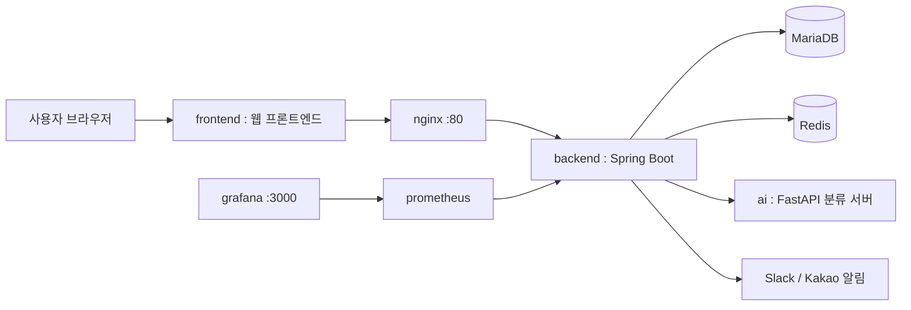

# 수박 (Subak) - 사물함 관리 시스템

## 1. 서비스 소개

42 경산 캠퍼스의 사물함 대여/반납을 관리하는 서비스다. 사용자는 42, 카카오, 구글 OAuth 로 로그인해 사물함을 대여하고 반납하며, 관리자는 사물함 상태와 사용자를 관리한다. 반납 시 올린 사진은 AI 서버가 비어 있는지 판별해 반납 처리를 돕는다.

구성은 세 부분으로 나뉜다.

- **backend**: 대여/반납, 인증, 결제(코인/상점), 알림(슬랙/카카오), 통계를 담당하는 API 서버
- **ai**: 반납 사진으로 사물함이 비었는지 판별하는 이미지 분류 서버 (EfficientNetV2-S 기반)
- **frontend**: 별도 팀원이 추가할 예정인 사용자 화면 (현재 저장소에는 없음)

## 2. 실행 환경 및 필요한 도구·버전

| 구분 | 버전 |
|---|---|
| Java | 17 |
| Spring Boot (backend) | 3.5.8 |
| Spring Boot (ai/webapp, 테스트용) | 3.2.0 |
| Python | 3.11 |
| FastAPI | 0.115.6 |
| PyTorch | 2.2.2 |
| MariaDB | 10.6 |
| Redis | alpine (latest) |
| Docker / Docker Compose | 최신 안정 버전 |

로컬에 Docker 없이 실행하려면 Java 17, Python 3.11, MariaDB, Redis를 직접 설치해야 한다. 프론트엔드에 필요한 Node 버전 등은 [frontend/README.md](frontend/README.md) 를 참고한다.

## 3. 설치 방법 및 실행 방법

```bash
git clone https://github.com/farmer0010/42_subak_be_ai.git
cd 42_subak_be_ai
make up      # .env 생성 안내 → backend 빌드 → 전체 컨테이너 기동
make seed    # 가짜 사물함/사용자 데이터 시드
make check   # 상태 확인용 API 호출
```

`make` 없이 직접 실행하는 방법, 컨테이너 없이 로컬에서 띄우는 방법, 개별 서비스 세부 설정은 각 폴더의 README 를 참고한다.

- backend 상세: [backend/README.md](backend/README.md)
- ai 상세: [ai/README.md](ai/README.md) (이 서버는 [42-Gy/ft_cabinet_AI](https://github.com/42-Gy/ft_cabinet_AI) 기반이다)
- 프론트엔드 설치와 실행은 [frontend/README.md](frontend/README.md) 를 따른다.

## 4. 환경 변수 설정 방법

```bash
cp .env.example .env
```

`.env.example` 의 값은 모두 자리표시자다. `.env` 는 git에 올리지 않는다. 필수 항목은 DB 계정/비밀번호, JWT 시크릿, 42/카카오/구글 OAuth 클라이언트 정보, 슬랙 봇 토큰, Azure Blob Storage 연결 문자열, AI 모델 경로(`AI_MODEL_PATH`)다. `#` 으로 시작하는 줄은 선택 항목이며 적힌 값이 기본값이다. 변수별 설명은 `.env.example` 안의 주석과 [backend/README.md](backend/README.md) 를 참고한다. 프론트엔드 환경 변수는 [frontend/README.md](frontend/README.md) 를 참고한다.

## 5. 접속·확인 방법

`make up` 으로 전체 스택을 띄운 뒤:

- API: `http://localhost`
- Swagger: `http://localhost/swagger-ui/index.html`
- Grafana: `http://localhost:3000` (admin / admin)
- AI 서버 상태: `make check-ai` (컨테이너 내부 네트워크 전용, 호스트에는 `127.0.0.1:8000` 으로만 열림)
- 프론트엔드: (제출 시 기재)
- 배포 주소: (제출 시 기재)

로그인은 42/카카오/구글 OAuth 뿐이며, 별도의 테스트 계정은 제공하지 않는다. 시드로 넣는 `demo-*` 사용자는 DB 데이터일 뿐 로그인 계정이 아니다.

---

## 폴더 구조

| 폴더 | 내용 |
|---|---|
| `backend/` | API 서버 (Spring Boot) |
| `ai/` | 이미지 분류 서버 (FastAPI + PyTorch), 테스트용 웹앱 포함 |
| `frontend/` | 웹 프론트엔드. 설치·실행은 frontend/README.md 참고 |

## 구조도


