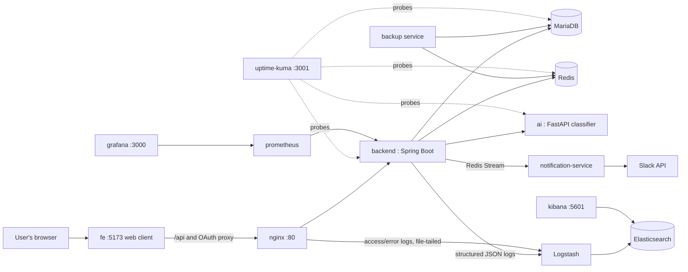
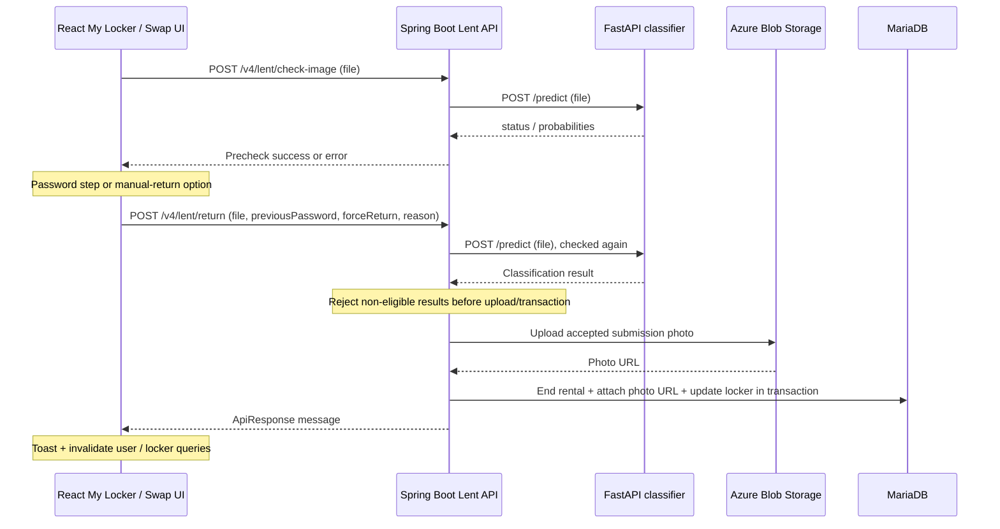
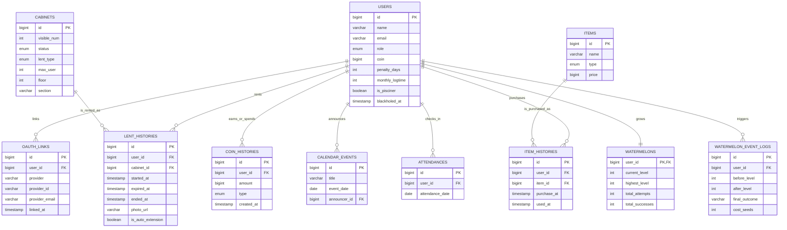

*This project has been created as part of the 42 curriculum by juyoukim, seonghan, byoulee, taewonki.*

# Subak (수박) — Campus Locker Management System

> **Live service: https://subak.site/**

## Description

Subak is a full-stack web application that manages locker rental and return for the 42 Gyeongsan campus, adapted from the team's operational SUBAK platform for the final 42 Common Core project. Users first register through 42 OAuth and can then link Kakao or Google for subsequent sign-in. They browse, rent, return, and reserve lockers, while admins manage locker status and user accounts from a dedicated dashboard. A separate AI image-classification server checks return photos: an accepted automatic return releases the locker, while an eligible manual return ends the rental and leaves the locker pending administrator review.

The live service is available at **[https://subak.site](https://subak.site)**. Features that require authentication (renting, returning, reserving, the coin store, the attendance check-in, etc.) are best explored there; the local setup below is intended for building, booting the stack, and exercising the public API.

The core application is three services, backed by a small fleet of infrastructure services:

- **backend** — the API server responsible for rental/return workflows, OAuth authentication, the coin wallet and store, admin statistics, and bulk data export/import. Publishes events for notifications; never calls Slack directly.
- **ai** — an image-classification server (EfficientNetV2-S) that decides whether a returned locker is actually empty from the uploaded photo.
- **fe** — the React + TypeScript web client: locker browsing, rental/return/reservation, "my locker," the coin store, attendance, and the admin screens. Watermelon event UI source is retained under `fe/etc/`, outside the active application.

Supporting infrastructure: **notification-service** (the only service that calls the Slack API, decoupled from the backend via a Redis Stream), **Elasticsearch/Logstash/Kibana** (centralized structured logging), **Uptime Kuma** (a public status page), a **backup** service (scheduled MariaDB/Redis backups with a tested restore path), and **Prometheus/Grafana** (metrics). See [docs/architecture.md](docs/architecture.md) for how they fit together.

### Key features

- Sign-in via 42 OAuth 2.0 and linked Kakao/Google accounts (no local password accounts)
- Locker browsing, rental, return, and reservation with a shared reservation calendar
- AI-assisted return verification from a photo, backed by a dedicated microservice
- A coin wallet and item store, plus backend APIs for a "watermelon" gamification event with levels and a leaderboard (its retained frontend is not currently routed)
- Daily attendance check-in that rewards users with coins
- Slack notifications for rental/return/overdue events, delivered by an independent notification-service via a Redis stream
- An admin dashboard for user, locker, and ban management with usage statistics
- Admin bulk data export (JSON/CSV/XML) and validated locker import
- Centralized structured logging (Elasticsearch/Logstash/Kibana) and a public status page (Uptime Kuma), on top of Prometheus/Grafana metrics and a Swagger-documented public API
- Scheduled, verified backups of MariaDB and Redis with a one-command disaster-recovery rehearsal
- A `make up` target builds, starts, health-checks, and seeds the stack, subject to the prerequisites below

The implementation descriptions below follow this checkout. The existing module claims and team assignments are retained; [the implementation and evaluation audit](docs/implementation-audit.md) records documentation differences, verification limits, and open checks against the requested ft_transcendence v21.1 requirements.

## Instructions

### Prerequisites

| Component | Version |
|---|---|
| Git LFS | Required for the model and PNG/JPG/JPEG assets tracked by `.gitattributes` |
| Java | 17 |
| Node.js (only needed to develop/build the FE on the host) | 22+ |
| React / TypeScript / Vite (fe) | 19 / 5.9 / 5 |
| Spring Boot (backend) | 3.5.8 |
| Spring Boot (ai/webapp test harness) | 3.2.0 |
| Python | 3.11 |
| FastAPI | 0.115.6 |
| PyTorch | 2.2.2 |
| MariaDB | 10.6 |
| Redis | alpine (latest) |
| Elasticsearch / Logstash / Kibana | 8.15.3 |
| Uptime Kuma | 1 |
| Docker / Docker Compose | latest stable |

`make up` builds the FE inside a Node.js 22 Docker image, so Node.js is not required on the host for that path. **Java 17 is required on the host:** the Makefile builds the backend and notification-service JARs with their Gradle wrappers before starting Docker. The FE dev server (`make fe`) and a host build (`make build`) require Node.js 22+ and npm. Running everything without Docker additionally requires installing Python 3.11, MariaDB, and Redis yourself. See [fe/README.md](fe/README.md) for FE-specific setup.

### Running the project

```bash
git lfs install
git clone https://github.com/farmer0010/ft_transcendence.git
cd ft_transcendence
git lfs pull
make up
```

Install Git LFS before the commands above. A checkout containing only LFS pointer text cannot load the TorchScript model or display the affected images. In particular, `ai/models/efficientnetv2s_3class_traced_v2.0.0.pt` must be the 82,618,232-byte binary described by its pointer, not a small text file. Fetching the LFS objects requires access to the repository's LFS storage; a successful FE build alone does not verify image availability.

`make up` generates `.env`/`fe/.env` from the example files if they don't exist yet, builds the backend and notification-service JARs and the FE bundle, starts every container (app services, AI, nginx, MariaDB/Redis, ELK, Uptime Kuma, Prometheus/Grafana, the backup service), waits for them to report healthy, seeds the 304 lockers (safe to run again — it's idempotent), and runs a smoke check against the FE and the public API. Build/download and startup time depend on the host and cached dependencies. This documentation review validated the Compose configuration, but could not rerun full startup because the Docker daemon was unavailable and LFS binaries were not materialized.

Open **http://localhost:5173** in a browser. FE requests to `/api/v4/*` are proxied through Nginx to the local backend's `/v4/*`. Routes such as `/lockers` can also be opened or refreshed directly.

`make seed`, `make check`, and `make check-fe` still exist standalone if you need to re-seed or re-verify without a full `make up`.

To develop against the FE while the rest of the stack is running, stop the FE container first (it shares port 5173 with the dev server) and start the dev server:

```bash
docker compose stop fe
make fe       # npm ci, then the Vite dev server on http://localhost:5173
```

`make fe` only starts the FE dev server, so the backend must already be running to exercise the public API. If the backend is running on the host via `make run` (port 8080), point the dev server at it from another terminal with `FE_API_TARGET=http://localhost:8080 make fe`. The default proxy target is `http://localhost`.

Key `make` targets:

| Command | Description |
|---|---|
| `make build` | Build the backend/notification-service JARs and type-check/build the FE for production |
| `make build-fe` | Install FE dependencies (`npm ci`) and type-check/build |
| `make logs-fe` | Tail the FE container logs |
| `make down` | Stop every container, including FE, keeping data |
| `make backup` | Run a MariaDB + Redis backup immediately |
| `make restore` | Restore from the newest backup (`make restore TARGET=redis`, `FILE=...` to pick a specific one) |
| `make dr-test` | Automated rehearsal: backup → wipe the DB → restore → verify the data is back |

For running services without `make`, running locally without containers, or per-service configuration, see each folder's README:

- Backend: [backend/README.md](backend/README.md)
- AI service: [ai/README.md](ai/README.md) (based on [42-Gy/ft_cabinet_AI](https://github.com/42-Gy/ft_cabinet_AI))
- Frontend: [fe/README.md](fe/README.md)
- Service boundaries and the notification event flow: [docs/architecture.md](docs/architecture.md)
- Backup/restore and disaster recovery: [docs/disaster-recovery.md](docs/disaster-recovery.md)
- Step-by-step demo instructions for every module below: [docs/eval-demo.md](docs/eval-demo.md)

### Environment variables

```bash
cp .env.example .env
cp fe/.env.example fe/.env
```

`make env` generates both files as well. Values in `.env.example` are placeholders; real values belong in the git-ignored `.env`. Required variables include DB credentials, the JWT secret, 42/Kakao/Google OAuth client credentials, the Slack bot token, the Azure Blob Storage connection string, the AI model path (`AI_MODEL_PATH`), the Elasticsearch/Kibana/Logstash account passwords (`ELASTIC_PASSWORD`, `KIBANA_SYSTEM_PASSWORD`, `LOGSTASH_WRITER_PASSWORD`), and the Uptime Kuma admin account (`UPTIME_KUMA_ADMIN_USER`/`UPTIME_KUMA_ADMIN_PASSWORD`). Lines starting with `#` are optional and already show their default. See the comments in `.env.example` and [backend/README.md](backend/README.md) for details on each variable.

The FE dev server reads `fe/.env`. By default it uses the local API with `VITE_API_BASE_URL=/api` and `VITE_USE_MOCK=false`. `VITE_*` values end up in the browser bundle, so secrets never go there. The FE container is built from `fe/.env.example`; a personal `fe/.env` is never baked into the Docker image. See [fe/README.md](fe/README.md) for the full variable list.

Running locally with placeholders left as-is applies these effective values:

- `REDIS_PORT=6379`
- `FRONTEND_URL=http://localhost:5173`
- `COOKIE_SECURE=false`
- `AI_MODEL_PATH=models/efficientnetv2s_3class_traced_v2.0.0.pt`

The default FE origin `http://localhost:5173` is already in the backend's CORS allow-list. If you are reusing an existing `.env`, update `FRONTEND_URL` to that value.

The application configuration permits placeholder OAuth, Slack, and Azure values for public-API exploration; this is not a fresh end-to-end startup guarantee. The following features need real credentials:

| Feature | Works with placeholders? | Reason |
|---|---|---|
| 42 / Kakao / Google login | No | The redirect to the real provider happens, but the fake client ID/secret fails authentication on the provider's side. |
| Slack notifications | No | The token isn't validated at boot, but real Slack API calls fail authentication. |
| Return-photo upload | No | Creating the Azure Blob client doesn't block boot, but the actual upload fails with fake credentials. |

With placeholders in place, only public endpoints such as locker listing/status work; renting, returning, and extending require OAuth login.

The root `docker-compose.yml` does not forward every optional variable to the `backend` service (e.g. `SLACK_NOTICE_*`, `SLACK_REPORT_*`, `GEMINI_API_KEY`, `APP_AUTH_COOKIE_SECURE`) — setting them in `.env` has no effect on containers started with `make up`.

The root `.env.example` matches the local `docker-compose.yml` for demo purposes. `backend/.env.example` documents the production profile (externally managed DB, SSL Redis) and is not used by the local compose setup.

### Accessing and verifying the stack

Once `make up` has started the full stack:

- API: `http://localhost`
- Local frontend: `http://localhost:5173`
- Swagger: `http://localhost/swagger-ui/index.html`
- Grafana: `http://localhost:3000` (admin / admin)
- Kibana (logs): `http://localhost:5601` (log in as `elastic` with `ELASTIC_PASSWORD` from `.env`)
- Uptime Kuma (status page): `http://localhost:3001` (log in with `UPTIME_KUMA_ADMIN_USER`/`UPTIME_KUMA_ADMIN_PASSWORD` from `.env`)
- AI service health: `make check-ai` (only reachable on the internal Docker network, exposed on the host as `127.0.0.1:8000`)
- Locker status summary (no login required): `curl http://localhost/v4/cabinets/status-summary/all` (same call as `make check`)
- Admin data export (requires an admin session): `curl http://localhost/v4/admin/data/export/cabinets?format=csv`
- Deployed instance: https://subak.site

Public application reads include `GET /v4/cabinets`, `GET /v4/cabinets/{id}`, `GET /v4/cabinets/status-summary`, `GET /v4/cabinets/status-summary/all`, and Swagger. `SecurityConfig` also permits `/v4/auth/**` through the security filter; individual operations still depend on a valid refresh cookie or principal. Other `/v4/**` routes require OAuth authentication, and `/v4/admin/**` requires the ADMIN role. Internally, `/actuator/health` and `/actuator/prometheus` are public for health checks and metrics; other actuator routes require ADMIN, and Nginx blocks external `/actuator` access.

Login only works through 42/Kakao/Google OAuth; no test accounts are provided, and the seed data contains only lockers, not accounts.

To log in locally, register real OAuth client credentials and set each provider's redirect URI to `{FRONTEND_URL}/login/oauth2/code/{42|kakao|google}` (by default `http://localhost:5173/login/oauth2/code/42`, etc.). Compose and `make run` override the backend's OAuth redirect URI to this address. The FE proxies `/oauth2/*` and `/login/oauth2/*` to the backend. Login fails if `FRONTEND_URL` doesn't match the registered redirect URI exactly.

**Local authentication limitation:** the OAuth request, login-success, reissue, and logout code hard-code `Secure; SameSite=None` cookies. `COOKIE_SECURE=false` does not switch those builders to non-secure cookies; the `app.auth.cookie-secure` field in `AuthController` is unused. The checked-in local proxies serve HTTP and do not configure TLS. Browser handling of secure cookies on localhost needs testing; real credentials alone do not establish that local login works. See [Authentication & Token Management](#authentication--token-management) and the audit before an authenticated evaluation.

### Folder structure

| Folder | Content |
|---|---|
| `backend/` | API server (Spring Boot) |
| `ai/` | Image classification server (FastAPI + PyTorch), including a test webapp |
| `fe/` | Web frontend (React + TypeScript + Vite), with Docker/Nginx configuration |
| `notification-service/` | Slack notification delivery (Spring Boot), split out of the backend |
| `elk/` | Logstash pipeline config and the Elasticsearch/Kibana setup + dashboard-import scripts |
| `uptime-kuma/provision/` | One-shot container that auto-creates the status page's monitors |
| `backup/` | MariaDB/Redis backup + restore scripts and the service that runs them on a schedule |
| `scripts/` | Host-side scripts (currently the disaster-recovery rehearsal) |
| `docs/` | Architecture, disaster-recovery, and evaluation-demo documentation |

### Architecture



## Team Information

| Member | Role(s) | Responsibilities |
|---|---|---|
| **juyoukim** | Technical Lead, Backend & Infrastructure Developer | Backend architecture, API design, database integration, OAuth/auth logic, Docker/Nginx deployment, logging/monitoring/status-page infrastructure |
| **seonghan** | Product Owner, Project Manager, Frontend Developer, AI Developer | Product vision and feature prioritization, sprint planning and scheduling, frontend feature screens, the AI return-verification model and service |
| **byoulee** | Project Manager, Frontend Developer | Task tracking and scheduling, frontend feature screens, UI consistency |
| **taewonki** | Developer (Documentation / QA) | Documentation upkeep, issue tracking, release validation |

## Project Management

The team split work along backend/infrastructure, frontend, AI, and documentation lines, with the two frontend developers sharing project-management duties (scheduling, task tracking, and keeping the team unblocked).

- **Task & schedule tracking**: Notion, used for planning boards, decisions, and documentation drafts
- **Day-to-day communication**: Slack, for async updates and quick questions
- **Meetings**: Discord, for voice stand-ups and pairing sessions
- **Code review**: Git/GitHub, through feature branches and pull requests
- **Delivery model**: backend, frontend, and AI work proceeded in parallel and were integrated through shared API contracts, with documentation kept up to date alongside implementation

## Technical Stack

### Frontend

- React 19, TypeScript 5.9, Vite 5, React Router DOM 7
- Chakra UI 2, Emotion, Framer Motion, React Icons, and a custom watermelon color palette
- TanStack Query v5 for server state; Axios for public, authenticated, and token-reissue requests
- Feature-oriented directories and Atomic Design-inspired shared components
- ESLint 9 Flat Config, TypeScript/React Hooks rules, Prettier 3 and import sorting (`fe/.prettierrc`)

**Why this choice:** React's component model keeps a growing number of screens (lockers, calendar, store, attendance, admin) organized, TypeScript catches integration errors against the backend's API contracts early, and Vite keeps local iteration fast.

#### Frontend Architecture

The frontend separates route composition, reusable presentation, domain workflows, and HTTP infrastructure. Paths below are relative to [`fe/src/`](fe/src/).

| Directory | Responsibility and concrete examples |
|---|---|
| `app/` | `App.tsx`, `router/routes.tsx`, route pages, and `providers/AppProviders.tsx`; composes Chakra and one QueryClientProvider, preloads the shared user query, and mounts the browser router |
| `components/atoms/` | `StateMessage`: shared title, description, icon, and status color |
| `components/molecules/` | `EmptyState`, `ErrorState`, `LoadingState`, and `PageHeader`; reusable empty/error/loading presentation and retry callbacks without HTTP calls |
| `components/organisms/` | `ResponsiveCarousel`: reusable slide presentation and navigation; retained in the component library, but not mounted by the current home page |
| `components/templates/` | `AppLayout`: common navigation, mobile menu, theme toggle, session controls, and router `Outlet`; obtains user data through `useAuthSession` |
| `features/` | `auth`, `users`, `lockers`, `store`, `attendance`, `calendar`, `admin`, `status`, and `map`; keeps API wrappers, hooks, domain types/data, and feature components together where needed |
| `libs/` | Shared `axios` clients/response normalization, `query/queryClient`, environment parsing, and the legacy bearer-token store |
| `styles/`, `types/`, `utils/` | Chakra theme/global fonts, common locker/user contracts, and date/time helpers; `@/*` aliases are configured in both Vite and TypeScript |

Atomic Design is applied selectively: `EmptyState` and `ErrorState` compose the same atom, while feature components such as `FloorSectionMap`, `LockerGuideModal`, and `ReservationPanel` stay beside locker workflows rather than becoming global UI. The custom theme defines `brand`/`leaf` colors, typography, a button variant, and light/dark styles. This gives pages shared visual and failure states without putting endpoint knowledge into those presentation primitives.

The intended dependency path is **pages/components → feature hooks → API wrappers → shared Axios utilities**. TanStack Query owns remote state; React state/refs hold local selections, modal steps, camera resources, and submission guards. There is no installed Recoil dependency or active feature `state/` directory. Features share the `users` query and locker hooks where appropriate; this is a practical layered organization, not a complete implementation of a formal Feature-Sliced Design specification.

[`fe/eslint.config.js`](fe/eslint.config.js) uses `no-restricted-imports` to reject specified `@/features/*/api/*`, `state`, and Axios imports from pages/components, and rejects React/hooks/state imports in API files. State/Recoil restrictions remain as configuration for those paths. These are import-pattern checks, not a complete dependency-graph proof: `useAuthSession` calls Axios directly, `AuthCallbackPage` imports `fetchMe` directly and currently fails that lint rule, and the large locker pages still contain substantial workflow logic. Prettier configures formatting/import order separately; `npm run lint` does not execute Prettier. See the [audit](docs/implementation-audit.md#verification-record) for the existing lint failures.

#### Authentication & Token Management

The active login flow is **cookie-based**, as confirmed across [`socialAuth.ts`](fe/src/features/auth/api/socialAuth.ts), [`AuthCallbackPage.tsx`](fe/src/app/routes/AuthCallbackPage.tsx), and the backend's [`OAuth2SuccessHandler`](backend/src/main/java/com/gyeongsan/cabinet/auth/oauth/OAuth2SuccessHandler.java):

1. A provider button navigates to same-origin `/oauth2/authorization/{42|kakao|google}`; Vite or the FE Nginx proxy forwards OAuth requests/callbacks to Spring Security. `CustomOAuth2UserService` creates/updates the campus user through 42; Kakao/Google login requires a previously linked account.
2. The backend stores the refresh token in Redis under `RT:{userId}` and sets **both** `access_token` and `refresh_token` as `HttpOnly; Secure; SameSite=None` cookies. It redirects to `/auth/callback`, without a token fragment.
3. `AuthCallbackPage` calls `fetchMe()` (`GET /v4/users/me`), writes the result into the shared `['me']` query, and navigates home; failed confirmation shows a retry/login screen. `AppProviders` also mounts `MePrefetcher`, so header and feature screens read the same cached user rather than maintaining separate copies.
4. The authenticated [`apiClient`](fe/src/libs/axios/client.ts) sends cookies with `withCredentials: true` and uses a 20-second timeout. On a 401, a shared `refreshPromise` groups concurrent reissue attempts, `_retry` limits each original request to one retry, and a separate client posts to `/v4/auth/reissue`. The backend validates the refresh token against Redis and sets a new access cookie; no token is read from the response body.
5. On reissue failure, the client redirects to `/` and rejects the request. It does **not** clear the legacy bearer store there. `fetchMe()` deliberately sends `X-Skip-Reissue` and maps 401 to `null`, so initial session checks do not automatically refresh an expired access cookie. Explicit logout clears cookies server-side, clears the legacy store, sets `['me']` to `null`, and reloads home.

Kakao/Google **account linking** is a separate flow: `startOAuthLink` stores provider/state in `sessionStorage`, navigates to the provider, and `SocialLinkCallbackPage` consumes and compares the returned state before posting the authorization code to `/v4/auth/link/{provider}`. Successful linking invalidates `['me']`; local link-status markers are UI hints, not authorization evidence.

Legacy fragment-token hooks (`useAuthBootstrap`, `AuthTokenProvider`) and `tokenStore` still exist, but the provider/bootstrap hook is not mounted in the current application. `main.tsx` does not parse `#token=`. The Axios interceptor can still attach `Authorization: Bearer ...` from `localStorage('subak_access_token')`; the backend gives that header precedence over the access cookie. A stale stored bearer can therefore prevent a refreshed cookie from fixing a retried request. Cookie `HttpOnly` limits direct JavaScript token reads, while the retained localStorage path remains script-readable. `SecurityConfig` disables CSRF and accepts credentialed requests from configured origins; cookie flags/CORS alone are not a complete CSRF or XSS defense. Local HTTP/TLS limitations are described under [Instructions](#instructions).

#### Server State & API Integration

Queries read and cache remote data; mutations perform actions and refresh affected queries. [`queryClient.ts`](fe/src/libs/query/queryClient.ts) defaults to a 30-second stale time, one query retry, and no window-focus refetch, with domain-specific overrides:

| Server state | Query keys and refresh policy |
|---|---|
| Current user | `['me']`; 60-second stale time, no query retries; locker/my-locker pages request refresh on mount and focus through `useMeQuery(true, true)` |
| Locker lists and summaries | `['cabinets', 'list', floor]`, `['cabinet-summary', floor]`, `['cabinet-summary-all']`; lists refetch on mount/focus, summaries disable retries and focus refetch |
| Locker detail | `['cabinet-detail', cabinetId, authenticated]`; enabled only for a numeric ID, refetches on mount/focus; authenticated/public detail results occupy separate cache entries |
| Store / attendance | `['store-items']` and `['attendance']`; enabled after user confirmation |
| Calendar / administration | `['calendar', 'events', start, end]` and `['admin', ...]` keys including applicable filters/page values; calendar mutations invalidate the calendar root |

[`useLockerData.ts`](fe/src/features/lockers/hooks/useLockerData.ts) centralizes locker mutations and invalidates list, floor summary, total summary, detail, and `['me']` after successful rent/return, ticket purchase/use, renewal, and auto-extension updates. This refreshes the wallet/inventory and locker views from the server. Reservation creation/replacement/cancellation invalidate on **settlement**, including errors; rent/swap also refresh on error because a request may have committed even if its response was lost. Reservation POSTs have no automatic mutation retry. A cancellation 404 is treated as an already-absent reservation; other errors retain state until the server is queried again.

For example, first rental runs the server-driven guide → `POST /v4/lent/reservation/{visibleNum}` when needed → fresh `GET /v4/users/me` → `POST /v4/lent/cabinets/{visibleNum}` → invalidation and a local rented-status hint reconciled with later list data. An item purchase posts the catalog's `itemId` and refreshes `['me']`; attendance posts `/v4/users/attendance` and invalidates both `['attendance']` and `['me']`, updating calendar marks and coins. API wrappers normalize the backend's `data` envelope, and hooks render backend/network errors through Chakra toasts; pages provide loading, empty, error, and retry views.

These policies share requests/cache entries and reduce stale views; they do not guarantee real-time synchronization across browsers. The active locker UI uses HTTP queries, focus refreshes, and a local reservation clock, without a WebSocket/SSE subscription. Admin operations often use explicit per-view `refetch()` rather than the locker-wide invalidation helper, so invalidation is not universal.

#### Main Features & User Flow

| Screen / scope | Verified behavior and source |
|---|---|
| Home `/` | `HomePage` renders a responsive hero, a SUBAK STORIES label and locker CTA. `HomeOverview` combines public total/floor summaries, section availability highlights, and three guide cards opening explanatory modals. The separate `ResponsiveCarousel` is retained, not used here. |
| Locker management `/lockers` | `LockersPage` combines `FloorSectionMap` with floor/section selection, a paginated locker grid, status legend, and detail Drawer. Detail uses database `cabinetId`; reservation/rent/swap use display `visibleNum` (the resolver currently returns its input unchanged). Availability, ownership, and server `isFirstRental` control actions. |
| Rental guidance | `useRentalOnboarding` shows the seven-step guide only for server-confirmed first rentals; an unknown flag blocks submission and offers refresh. `LockerGuideModal` reuses eight instructional images for full onboarding and contextual help, with focus movement, alt text, and a mobile full-screen layout. Closing before final confirmation makes no rental request. |
| Reservation / replacement | One POST atomically creates/replaces the backend reservation; an existing reservation for the same number is reused without extending its deadline. `ReservationPanel` supports resume/cancel. `useReservationClock` derives a deadline from server remaining seconds and query update time, refreshes on expiry/visibility changes, and avoids repeated expiry refreshes. Submission refs and pending controls reduce duplicate clicks; server locking/Lua scripts decide concurrent outcomes. |
| My Locker `/my/lockers` | Shared profile, current rental, expiry, wallet/inventory and history, renewal, auto-extension, extension/penalty tickets, and navigation to a reserved swap. Return/swap use camera capture into a JPEG `File`, preview, AI precheck, then a four-digit password field and multipart submission. Camera tracks/object URLs are released on close/cleanup. Two precheck errors offer manual submission; this is a UI counter, including network errors. |
| Store `/store` | Fetches the server catalog/prices, decorates items by type, disables rental-ticket purchases and extension purchases for pisciners, and posts the selected server `itemId`. Only the clicked card shows purchase loading; errors are surfaced and the wallet/inventory is refreshed on success. Static `STORE_ITEM_IDS` remains in the source but is not the active catalog's ID source. |
| Attendance `/attendance` | Authenticated check-in, month navigation, marked attendance dates and calendar events; today's completed check-in disables the button. Successful check-in refreshes attendance and user data. |
| Administration `/admin` | `AdminGate` and navigation check the user role before rendering `AdminDashboard`: statistics, coin/item controls, user lookup and role/penalty management, locker status/bulk updates, pending-return approval, return-photo review, and calendar editing. The UI accepts `ADMIN`, `ROLE_ADMIN`, and `MASTER`; the backend separately requires `hasRole('ADMIN')`, so frontend visibility is not proof of backend permission. |
| Policies `/policy` | Locker operating terms, update date, contact text and an external rules link. This does not establish a complete privacy-policy page; most contact/terms content is hard-coded despite older environment-variable documentation. |
| Watermelon event | Backend enhancement/item/leaderboard/log/config APIs exist. The retained `fe/etc/watermelon-event/` page has enhancement states (`IDLE`, `ENHANCING`, `SUCCESS`, `MAINTAIN`, `DROP`, `DESTROY`), feedback, item controls and ranking UI; its hooks update cached balance/inventory and invalidate event queries. It is outside `src/`, has no active route/navigation entry, and its `@/features/watermelon-event/*` aliases do not resolve in the current app. It is historical source, not a runnable current screen. |

### Backend

- Java 17, Spring Boot 3.5.8, a hexagonal (ports & adapters) package structure
- Spring Data JPA, Spring Security, Resilience4j (rate limiting), springdoc-openapi (Swagger UI)
- Redis for caching, application distributed locks, ShedLock coordination of scheduled jobs, and Redis Streams that drive Slack notifications

**Why this choice:** Spring Boot's ecosystem covers authentication, validation, scheduling, and rate limiting out of the box, and the hexagonal structure keeps domain logic (lockers, rentals, coins, the watermelon event) independent from persistence and web adapters as the feature set grew.

### AI service

- Python 3.11, FastAPI, PyTorch, an EfficientNetV2-S image classifier

**Why this choice:** Running the classifier as its own FastAPI service keeps the heavier ML runtime isolated from the main API server, so it can be scaled, updated, or swapped independently.

#### AI Architecture & Model Lifecycle

The AI work addresses a concrete operational problem: a return photo may show an empty locker, remaining belongings, or an unsuitable image. [`train_torch.py`](ai/scripts/train_torch.py) starts from torchvision's pretrained `EfficientNet_V2_S_Weights.DEFAULT`, replaces `classifier[1]` with a three-output linear layer, and trains the model parameters. This reuses pretrained visual features while fitting the locker-specific labels. The repository demonstrates this transfer-learning choice and a CPU TorchScript deployment path; it contains no comparative study establishing that this architecture outperforms alternative models.

| Stage | Implementation |
|---|---|
| Labels / input | `empty=0`, `invalid=1`, `occupied=2` in the v2.0.0 metadata; decoded RGB input becomes a float tensor of shape `(1, 3, 384, 384)` |
| Shared preprocessing | `app/preprocess.py`: central 80% crop, optional LAB luminance-channel CLAHE, OpenCV resize to 384×384, scaling to `[0,1]`, mean `[0.485, 0.456, 0.406]` / std `[0.229, 0.224, 0.225]`, CHW layout and batch dimension. CLAHE is **disabled** in `config.py`. |
| Data preparation | `CabinetDataset` reads the three class directories. `augment_data.py` produces brightness/contrast/gamma, rotation/flip, shadow, gradient, noise and combined variants; training also applies random flips, rotations and brightness changes. Training data is ignored by Git; the scripts do not prove a particular dataset provenance or size. |
| Training configuration | Defaults: `data/train_augmented`, 10 epochs, batch 32, Adam at `1e-3`, seed 42, an 80/20 random split, inverse-frequency weighted cross-entropy and an additional 2× EMPTY weight. CUDA is chosen when available, otherwise CPU. These are script defaults, not a reconstructed training-run log. |
| Checkpoint / export | Best validation-accuracy weights are saved as a versioned `.pth` with JSON metadata. `export_torchscript.py` reconstructs the network without downloading pretrained weights, loads the state dict strictly, switches to evaluation mode, traces a fixed-size dummy input with `torch.jit.trace`, saves `.pt`, and copies metadata beside it. |
| Serving artifact | `config.py` and the CPU Dockerfile default to `models/efficientnetv2s_3class_traced_v2.0.0.pt`. Root Compose forwards `AI_MODEL_PATH` as `MODEL_PATH`. `_load_metadata` reads the adjacent `_metadata.json` (version, class count, threshold, input size, recorded accuracy). The model and image assets are tracked by Git LFS, contrary to an older AI README statement. |
| Runtime | `EfficientNetClassifier` caches one loaded model per process, uses `torch.jit.load(..., map_location='cpu')`, `.eval()`, four Torch threads by default, and `torch.inference_mode()`. The active classifier is CPU-only; `Dockerfile.gpu` does not change this device selection and is not selected by root Compose. |

The classifier applies softmax to the three logits and then uses explicit decision ordering in [`classifier.py`](ai/app/classifier.py):

1. If `P(invalid) >= 0.5`, return `INVALID`.
2. Otherwise, if `abs(P(empty) - P(occupied)) < 0.2`, return `UNKNOWN`.
3. Otherwise, if `P(occupied) > threshold` (metadata default `0.6`), return `OCCUPIED`.
4. Otherwise, return `EMPTY`.

`UNKNOWN` is an abstention decision, not a fourth trained class. Raising the occupied threshold favors EMPTY; it is not a stricter safety setting for accepting returns. `confidence` is the selected class probability (or the larger empty/occupied probability for UNKNOWN), not a calibrated guarantee of cleanliness or proof that the photographed locker is the correct one. ArUco-generation utilities exist under `ai/scripts/`, but no marker/locker-identity verification is called by the active `/predict` path.

#### Inference Server & Error Handling

[`app/main.py`](ai/app/main.py) initializes the model during FastAPI lifespan startup, so a missing/unreadable `.pt` prevents startup rather than waiting for a user's first upload. The CPU [`Dockerfile`](ai/Dockerfile) installs pinned dependencies from `requirements.txt`, copies code/model files, and runs one Uvicorn process on port 8000; Compose exposes it on host loopback only and the backend reaches `http://ai:8000` internally. `ai/webapp/` is a separate Spring Boot 3.2.0/Thymeleaf upload harness, not part of the production FE or root Compose services.

| API | Contract |
|---|---|
| `POST /predict` | Required multipart `file`, optional `threshold` query parameter; decode with OpenCV, BGR→RGB, preprocess and infer; returns `status`, `confidence`, all class `probabilities`, measured `latencyMs`, and an eight-character `requestId` |
| `GET /health` | Returns `status: "ok"`, `modelLoaded`, and `modelVersion`; the checked-in healthcheck tests HTTP reachability |
| `GET /model/info` | Reports model type/version and available metadata; `accuracy` is stored metadata, not a measurement made by the endpoint |

An undecodable image returns 400, a missing required upload is validated by FastAPI (422), and other exceptions become 500 responses. The optional threshold is documented as 0–1 but lacks explicit `ge`/`le` validation. The API reads the entire upload into memory and runs synchronous CPU inference inside an async handler; no inference queue or throughput/load-test result is provided. The outer Nginx and backend upload limits are separate from FastAPI's own handling.

#### Return Verification Across Frontend, Backend & AI

The browser never calls the AI service directly. The normal path includes a preview/precheck **and a second inference at final submission**:



[`LentController`](backend/src/main/java/com/gyeongsan/cabinet/adapter/in/web/lent/LentController.java) accepts the multipart payload and checks the password's four-digit format. [`AiServerAdapter.checkItem`](backend/src/main/java/com/gyeongsan/cabinet/adapter/out/external/ai/AiServerAdapter.java) maps EMPTY to success, OCCUPIED to `CABINET_NOT_EMPTY`, INVALID to `INVALID_IMAGE`, and UNKNOWN/unrecognized responses or communication failures to `AI_SERVER_ERROR`.

[`LentApplicationService.endLent`](backend/src/main/java/com/gyeongsan/cabinet/application/lent/LentApplicationService.java) performs AI and Azure I/O before the database transaction. An automatic accepted return ends the rental, stores the photo URL and releases a FULL/OVERDUE locker to AVAILABLE. With `forceReturn=true`, OCCUPIED or INVALID can use the manual path: the rental ends and the locker becomes PENDING with a review note/photo. UNKNOWN/AI-server failures still reject the request; manual mode is not a general outage bypass. Swap uses the corresponding single `/v4/lent/swap/{visibleNum}` operation to coordinate the old and new locker.

The frontend offers manual mode after two precheck errors, but the backend does not enforce that attempt count. A precheck pass is not a reusable authorization token, and the password field is recorded as a return memo rather than compared with a stored lock secret. Azure upload and the MariaDB transaction are not one atomic operation. These are integration limits, not claims that a classifier can verify physical lock reset or eliminate manual inspection.

#### Model Evaluation & Documented Challenges

[`ai/docs/model_evaluation.md`](ai/docs/model_evaluation.md), dated 2026-01-22, reports **100% accuracy on 305 train images** (80 EMPTY / 148 INVALID / 77 OCCUPIED) and **100% on 42 test images** (24 EMPTY / 0 INVALID / 18 OCCUPIED) for v2.0.0 at threshold 0.6. It reports 100% precision/recall for the represented test classes and zero for the unsupported INVALID test class. These are historical report values, not a new run, evidence of three-class test coverage, or a production guarantee. Metadata separately records best validation accuracy `0.9992548435171386`; the training code uses validation argmax accuracy, while the offline report uses classifier decisions and maps UNKNOWN back to argmax. Neither is an end-to-end return-acceptance metric. No F1 number is claimed here.

[`evaluate_model.py`](ai/scripts/evaluate_model.py) computes confusion matrices, accuracy, a classification report, and misclassified filenames from `data/train` and `data/test`. The current checkout has test images but no tracked training dataset or `.pth` checkpoint; LFS objects must also be fetched. The validation split is made after reading the augmented directory, and both subsets share a dataset with `augment=True`; there is no source-image grouping or deterministic, non-augmented validation pipeline. Independence of split samples and deployment behavior must be checked before interpreting these figures as generalization evidence. The older AI README's v2.1.0/98.7%/15ms claims do not match the configured artifact and are not adopted as current results.

The historical [CLAHE investigation](ai/docs/clahe_implementation_plan.md) identifies white paper against a white locker as a false-EMPTY case. It reports the same 85.7% result with and without CLAHE and attributes the issue to limited low-contrast samples. The retained response is configurable preprocessing, augmentation and Grad-CAM tooling, with CLAHE disabled and additional data/retraining left as a plan. There is no demonstrated CLAHE improvement in this checkout. `visualize_gradcam.py` uses a separately reconstructed `.pth` model and convolution activation/gradient hooks for diagnostic overlays; that training checkpoint must be supplied to rerun it.

### Database and cache

- MariaDB 10.6
- Redis

**Why this choice:** MariaDB models users, lockers, coin/item history, and the watermelon event with clear relational constraints; Redis provides fast caching, distributed locking for concurrent rentals, and the stream backing the notification pipeline.

### notification-service

- Java 17, Spring Boot 3.5.8, a thin single-purpose Redis Stream consumer

**Why this choice:** Slack delivery has its own external dependency and failure mode, and nothing to do with locker/rental logic. Splitting it into its own Spring Boot service (sharing almost no code with the backend) means a Slack outage or rate limit can never block a rental/return request, and either service can be deployed or restarted independently. See [docs/architecture.md](docs/architecture.md) for the full event flow.

### Logging — ELK

- Elasticsearch, Logstash, and Kibana (pinned 8.15.3)
- `logstash-logback-encoder` (backend/notification-service, streaming structured JSON over TCP) and a Logstash `file` input (nginx, via a shared log volume)

**Why this choice:** Centralizing logs from three independently-scaled services (backend, notification-service, nginx) is only useful once they're structured and searchable in one place. An ILM policy rolls over and deletes indices automatically, so retention doesn't need manual cleanup. See [docs/architecture.md](docs/architecture.md) for why each service's logs are collected the way they are (and why `ai`'s aren't, yet).

### Status page and backups

- Uptime Kuma, auto-provisioned with monitors for backend/ai/nginx/mariadb/redis on first boot
- A dedicated `backup` service running scheduled `mariadb-dump`/Redis `BGSAVE` backups, with a tested restore path and an automated DR rehearsal (`make dr-test`)

**Why this choice:** A status page and a backup strategy that nobody has verified actually restores data are both common sources of false confidence; both are provisioned automatically and the restore path is scripted and tested, not just documented. See [docs/disaster-recovery.md](docs/disaster-recovery.md).

### Infrastructure and tooling

- Docker / Docker Compose, Nginx, a Makefile for local automation
- Prometheus + Grafana for monitoring

**Why this choice:** Docker Compose gives the whole stack (DB, cache, AI service, backend, FE, reverse proxy, logging, status page, backups) a single-command local setup (`make up`), Nginx routes the FE, API, and OAuth callbacks consistently, and Prometheus/Grafana give visibility into the running service.

## Database Schema



### Core tables

- `users`: identity, OAuth-linked role, coin balance, and 42-campus metadata (penalty days, blackhole status)
- `oauth_links`: 42/Kakao/Google provider links per user
- `cabinets`: locker metadata, status, and position
- `lent_histories`: rental/return records, including the uploaded return photo
- `coin_histories`: ledger of coin earnings (attendance, watermelon event) and spending (store, admin grants)
- `items` / `item_histories`: the store catalog and each user's purchases
- `calendar_events`: reservation/announcement calendar entries
- `attendances`: daily check-in records
- `watermelons` / `watermelon_event_logs`: per-user gamification state and the history of each level-up attempt

## Features List

| Feature | Description | Team member(s) |
|---|---|---|
| OAuth login | Initial account through 42, then linked Kakao/Google sign-in, with role-based access | juyoukim |
| Locker browsing & status | Public locker listing and live status summary | juyoukim, byoulee |
| Rental, return & reservation | Rent/return lockers, extend rentals, reserve via a shared calendar | juyoukim, seonghan, byoulee |
| AI-assisted return verification | Photo precheck and final classification, with automatic acceptance or an eligible manual return pending admin review | seonghan |
| Coin wallet & store | Earn coins through attendance/events and spend them on store items | juyoukim, byoulee |
| Attendance check-in | Daily check-in rewarded with coins, tracked in admin statistics | juyoukim, seonghan |
| Watermelon gamification event | Level-up/protection/fertilizer and leaderboard backend; retained event UI under `fe/etc/` is outside the current app routes | juyoukim, seonghan |
| Admin dashboard | User, locker, and ban management with usage statistics | juyoukim, byoulee |
| Slack notifications | Rental/return/overdue events pushed to Slack via a Redis stream, delivered by an independent notification-service | juyoukim |
| Monitoring | Backend metrics visualized through Prometheus and Grafana dashboards | juyoukim |
| Public API | Swagger-documented REST API, authenticated and rate-limited | juyoukim |
| Admin data export/import | JSON/CSV/XML export of lockers/rental/coin history, and validated locker import (all-or-nothing, full per-row error report) | juyoukim |
| Centralized logging | Structured JSON logs from backend/notification-service/nginx, searchable in Kibana with a pre-built dashboard | juyoukim |
| Status page | Uptime Kuma, auto-provisioned monitors for every core service | juyoukim |
| Backup & disaster recovery | Scheduled MariaDB/Redis backups, a restore script, and an automated backup→wipe→restore→verify rehearsal | juyoukim |

## Modules

The tables and point allocations below retain the team's existing module selection. They are **claimed points, not a certification of subject compliance**. In particular, OAuth-only registration, local HTTP/cookie behavior, public-API key support, advanced-permission details, and the unrouted event UI need evaluation review. [The module-by-module audit](docs/implementation-audit.md#module-evidence-and-open-conditions) distinguishes code evidence from requirements that still need the authoritative v21.1 text and a live demonstration. No points have been added for the frontend documentation improvements.

| Module | Type | Points | Justification | Implementation | Team member(s) |
|---|---|---|---|---|---|
| Framework for both frontend and backend | Major | 2 | Clean separation between the UI and the API/domain logic | React + TypeScript frontend, Spring Boot backend | juyoukim, seonghan, byoulee |
| Advanced permissions system | Major | 2 | Admin-only actions (user/locker/ban management) need to be isolated from regular users | Role-based Spring Security rules, an admin dashboard restricted to the `ADMIN` role | juyoukim, byoulee |
| Public API with security and validation | Major | 2 | The locker/rental/store domain is exposed as a documented, protected API | Spring Security-protected REST endpoints, Resilience4j rate limiting, springdoc/Swagger documentation | juyoukim |
| Monitoring system (Prometheus + Grafana) | Major | 2 | A service handling real rentals needs visibility into health and load | Prometheus metrics scraping and Grafana dashboards wired into the Compose stack | juyoukim |
| Custom module: AI-based return verification | Major | 2 | Deciding automatically whether a locker photo shows it empty is a non-trivial ML problem, solved by a dedicated, independently deployed microservice rather than a simple rule; it directly gates the return workflow | A separate FastAPI/PyTorch service running an EfficientNetV2-S image classifier, called by the backend during the return flow | seonghan |
| Use an ORM for database access | Minor | 1 | Improves code quality and maintainability | Spring Data JPA entities and repositories | juyoukim |
| Remote authentication with OAuth 2.0 | Minor | 1 | Campus users already have 42/Kakao/Google accounts; a modern, secure external sign-in flow avoids password handling altogether | 42/Kakao/Google OAuth2 login and account linking | juyoukim |
| Notification system | Minor | 1 | Users and admins need to know about rental/return/overdue events without polling the app | Redis Stream events consumed by a Slack bot | juyoukim |
| Gamification system | Minor | 1 | Encourages daily engagement beyond the core rental flow | Watermelon leveling with a leaderboard, daily attendance check-ins, and coin rewards spendable in the store | juyoukim, seonghan |

### Module score (required 14 points)

- Major modules: 5 x 2 = 10 points
- Minor modules: 4 x 1 = 4 points
- **Total: 14 points**

### Bonus modules (beyond the required 14)

| Module | Type | Points | Justification | Implementation | Team member(s) |
|---|---|---|---|---|---|
| Infrastructure for log management (ELK) | Major | 2 | Three independently-scaled services (backend, notification-service, nginx) each log separately; centralizing and indexing them is the only way to actually search/correlate a failure across services, and the required components (ILM retention, access control, a dashboard) are all in place | Elasticsearch + Logstash + Kibana, an ILM policy with automatic rollover/delete, a least-privilege Logstash writer account, a Kibana dashboard (error rate / log volume by service / level distribution) auto-imported on boot | juyoukim |
| Backend as microservices | Major | 2 | Slack delivery has its own external dependency and failure mode and shares no business logic with the backend; splitting it out means a Slack outage/rate limit can never block a rental or return | notification-service: a standalone Spring Boot app consuming a Redis Stream, with its own Dockerfile, health check, and a dedup guard against redelivery | juyoukim |
| Health check/status page with automated backups and DR | Minor | 1 | A status page and a backup strategy are only trustworthy if the restore path has actually been exercised, not just documented | Docker healthchecks on every service, Uptime Kuma with auto-provisioned monitors, scheduled MariaDB/Redis backups, and `make dr-test` (backup → wipe → restore → verify) | juyoukim |
| Data export and import | Minor | 1 | Admins need to get locker/rental/coin data out in a format they can analyze or hand off, and bulk-load lockers without touching SQL directly | `/v4/admin/data/export/*` (JSON/CSV/XML, streamed) and `/v4/admin/data/import/cabinets` (all-or-nothing validation with a full per-row error report) | juyoukim |

Raw bonus total is 6 points (2 Major + 2 Minor). The existing scoring plan applies a 5-point bonus cap (e.g. both Major modules + one Minor); confirm that cap and actual credit against the authoritative subject and evaluator. Demo steps for every module above, bonus included, are in [docs/eval-demo.md](docs/eval-demo.md); the per-module reasoning (what was and wasn't implemented, and why) is in [docs/README_ADDITIONS.md](docs/README_ADDITIONS.md). Those documents contain historical verification claims, not results rerun during this README review.

## Resources & AI Usage

### Reference material

- Spring Boot Documentation: https://docs.spring.io/spring-boot/
- Spring Security Documentation: https://docs.spring.io/spring-security/
- React Documentation: https://react.dev/
- Vite Documentation: https://vite.dev/
- FastAPI Documentation: https://fastapi.tiangolo.com/
- PyTorch Documentation: https://pytorch.org/docs/
- Redis Documentation: https://redis.io/docs/
- MariaDB Documentation: https://mariadb.com/kb/en/
- Elasticsearch/Logstash/Kibana Documentation: https://www.elastic.co/guide/
- Uptime Kuma: https://github.com/louislam/uptime-kuma

### AI usage

AI tools were used to support documentation organization and technical research during the project — structuring this README, and looking up library/framework usage while implementing backend and infrastructure features. All AI-assisted output was reviewed and verified by the team before being used.

For this documentation revision, an AI coding assistant inspected local source, configuration, Git history and existing reports, drafted the frontend/AI explanations, and ran the FE build/lint and Compose configuration checks. The [audit](docs/implementation-audit.md) records what was actually checked and what remains unverified. No application behavior or model weights were changed. This use of an assistant is separate from SUBAK's deployed image-classification feature; historical AI-generated deployment guidance is treated as reference material rather than execution evidence.

## Individual Contributions

### juyoukim

- Designed the backend's hexagonal architecture and the API for lockers, rentals, the coin store, the calendar, and admin features
- Implemented 42/Kakao/Google OAuth login and role-based access control
- Built the Redis-backed caching, distributed locking, and the event stream powering Slack notifications
- Set up Docker Compose, Nginx routing, and the Prometheus/Grafana monitoring stack, and integrated the AI service into the return workflow
- Split Slack delivery into its own notification-service and added a dedup guard against redelivery
- Built the ELK logging stack (ILM retention, least-privilege accounts, an auto-imported Kibana dashboard), Uptime Kuma with auto-provisioned monitors, and scheduled/tested MariaDB+Redis backups with an automated DR rehearsal
- Added the admin bulk data export/import API (JSON/CSV/XML)
- Reworked `make up` into a single command that builds, starts, health-waits, and seeds the entire stack

Challenges and how they were solved:
- Slow admin queries: the admin lookup API took about 150ms because of N+1 queries. Using EXPLAIN to find the cause, I applied fetch joins, DTO projection, and a composite index, which brought it down to about 56ms (62% faster).
- Concurrent rentals: simultaneous requests for the same locker needed a guaranteed winner, so rental/reservation uses pessimistic locking. Coin deduction touches a single record, so it uses optimistic locking to avoid unnecessary overhead. Scheduled jobs (overdue fees, expiry) use ShedLock on Redis to prevent duplicate execution across instances.
- Unnecessary locks on reads: simple lookups were taking pessimistic locks and blocking each other, so I split them into a lock-free query.
- Slow external calls: Slack calls were moved off the request path onto a Redis Stream so rentals and returns no longer wait on an external API.

### seonghan — Frontend Developer / AI Developer

Frontend work was shared with **byoulee**; backend OAuth/security, rental transactions, Azure integration and infrastructure remain **juyoukim**'s responsibilities. The scope below expands the team-assigned frontend/AI contribution with concrete implementation references. This repository imported frontend and AI snapshots, so those references establish what exists, not sole authorship of every referenced file. See the [attribution evidence](docs/implementation-audit.md#contribution-attribution) for the remaining provenance limits.

#### 1. Product Ownership & Project Management

- Defined product priorities around the operational locker-rental/return experience and AI-assisted photo verification, as recorded in the team's Product Owner assignment.
- Planned sprints and coordinated frontend/AI integration and scheduling alongside the team's shared project-management responsibilities.

#### 2. Frontend Development

- **Architecture and reusable UI — shared frontend contribution:** organized route screens and domain hooks/API wrappers around `app/`, `features/`, and `libs/`, with Atomic Design-inspired shared presentation in `components/`. `StateMessage`/`ErrorState`/`EmptyState`/`LoadingState` make failures and retries consistent; `AppLayout` and `styles/theme.ts` carry navigation, responsive layout, typography, colors and theme switching. Import restrictions document and check intended layer boundaries, with current exceptions disclosed above.
- **Locker interaction and user guidance — shared frontend contribution:** the map → floor/section → locker grid → Drawer flow connects selection to server state in `LockersPage`. `LockerGuideModal`, `LockerHelpButton`, and `useRentalOnboarding` connect server-confirmed first-rental status to the seven-step walkthrough before submission. Contextual help preserves the underlying photo/password workflow.
- **Reservation and recovery — shared frontend contribution:** `ReservationPanel` and `useReservationClock` expose the server's active reservation, deadline, resume and cancel actions. `executeRental`/`handleSwapSubmit` recheck the current user, source rental and reserved display number before writes. The frontend requests one server-side reservation replacement rather than delete-then-create; its submission guards and error-settlement invalidation complement backend concurrency controls, which are not attributed to frontend work.
- **Return and item-use experience — shared frontend contribution:** `MyLockersPage` coordinates camera readiness/error feedback, JPEG capture and preview, AI precheck, password/manual-return steps, rental renewal, auto-extension, extension and penalty tickets, and navigation to the existing swap flow. Camera tracks and preview URLs are cleaned up; nested help keeps entered data available. The frontend prepares multipart requests, while the backend owns return acceptance and state transitions.
- **API/server-state integration — shared frontend contribution:** `useMeQuery` provides one user/wallet/inventory source for the header and pages; `useLockerData` separates reads/actions, interprets request errors, and refreshes user/locker caches after mutations. `AttendancePage` and `useAttendanceMutation` connect daily check-in and the month calendar to refreshed user rewards. `StorePage` decorates the server catalog and shows purchase loading on the selected card; the existing store/admin feature credits for byoulee and backend credits for juyoukim are retained.
- **Authentication integration — shared frontend contribution:** provider buttons, cookie-session confirmation in `AuthCallbackPage`, `useAuthSession`, account-link callbacks and the Axios reissue coordination connect the UI to juyoukim's backend OAuth implementation. The retained fragment/localStorage path is documented as legacy code, rather than described as the active sign-in flow or a new security achievement.
- **Watermelon event UI — retained contribution:** `fe/etc/watermelon-event/` contains level/outcome animation states, item selection, reward/balance feedback, rankings, and hooks that update event state after a response. It records frontend work associated with the event, but is currently excluded from the active route/build entry graph; it is not presented as an accessible screen.

#### 3. AI Development

- **Locker-image classification:** participated in development of the EfficientNetV2-S transfer-learning model for EMPTY/INVALID/OCCUPIED, rather than treating every uploaded image as a valid locker photo. `train_torch.py` replaces the classifier head, defines class-weighted training, selects the best validation checkpoint and writes versioned metadata.
- **Training/inference preparation:** contributed to the pipeline represented by `preprocess.py`, `augment_data.py`, and `export_torchscript.py`: shared crop/normalization choices, configurable contrast preprocessing, lighting/geometry augmentation, and a fixed-input TorchScript artifact for CPU serving. Defaults and historical measurements are distinguished from verified training runs.
- **FastAPI inference service:** contributed the service represented by `main.py`/`classifier.py`: startup initialization, a cached evaluation-mode model, multipart image decoding, threshold/uncertainty/invalid decisions, per-class probabilities, request identifiers, health/model metadata and error responses. The current default is v2.0.0 with CPU inference; GPU deployment and newer-model performance are not claimed.
- **Evaluation and diagnosis:** the AI area includes `evaluate_model.py` for confusion matrices/precision/recall and misclassified cases, `visualize_gradcam.py` for checkpoint-based visual diagnosis, and the historical low-contrast/CLAHE investigation. The report's sample coverage and reproduction limits are stated under [Model Evaluation](#model-evaluation--documented-challenges).
- **Return-verification contract — cross-team integration:** coordinated frontend image submission and AI status output with the backend's `AiCheckPort`/`AiServerAdapter` contract. The frontend precheck and final backend check, photo storage, automatic release and PENDING review path are explained together; the Spring/Azure transaction adapter implementation remains credited to juyoukim.

#### 4. Technical Challenges & Solutions

These cases describe mechanisms and investigations visible in source/documents. They do not assign sole authorship where the imported history cannot establish it.

| Problem and cause | Technical response | Verification evidence and limit |
|---|---|---|
| Wallet, inventory and locker views can disagree after a write when each screen keeps its own remote state. | Shared `['me']` and domain query keys; successful actions invalidate related data, with reservation errors also triggering reconciliation. | Hooks and call sites confirm the invalidation paths; attendance/return UI reads those queries. Admin refreshes and expired-session behavior still have exceptions. |
| A reservation can expire in a background tab, be replaced elsewhere, or commit while the browser loses the response. | Derive the timer from a server snapshot; refresh on visibility/expiry; resume using `visibleNum`; recheck profile/ownership before final writes; disable automatic reservation POST retries. | Stateful mock-API browser scenarios in `fe/tests/reservation.browser.cjs` cover replacement, timeout/network errors, cancellation and resume. Their previous results are documented in `fe/docs/reservation-integration.md`; they were not rerun here with missing LFS images. |
| Photo capture and AI rejection can interrupt an in-progress return. | Explicit photo/password/manual steps, capture readiness and permission messages, preview/track cleanup, retained form values during contextual help, and a manual-review option after two precheck errors. | `MyLockersPage`, `LockersPage`, and the existing browser scenarios show the flow. Fake-camera/mocked API checks cannot establish physical-device behavior or real AI accuracy. |
| Unsuitable or ambiguous photos should not silently become confident empty-locker decisions. | Three trained classes plus INVALID/UNKNOWN decision gates and backend status mapping; final submission repeats inference. | The current classifier/backend switch establishes the gates. INVALID has no test examples in the saved report; UNKNOWN is mapped to a server error, so workflow coverage is incomplete. |
| White paper against a white locker caused false-EMPTY results in the historical investigation. | Added configurable CLAHE/augmentation and diagnostic tooling; retained CLAHE disabled after the reported experiment showed no improvement, with more low-contrast data/retraining planned. | `clahe_implementation_plan.md` records 85.7% with and without CLAHE. The data/run artifacts are insufficient to reproduce that comparison here; no improvement is claimed. |
| Serving should not reconstruct a training setup for every request. | Export a fixed-input TorchScript artifact; initialize once at FastAPI startup and reuse the CPU model with `inference_mode()`. | Export/load/startup code establishes the mechanism. Real-model inference and latency were not rerun because this checkout contains only the LFS model pointer. |

### byoulee

- Implemented frontend feature screens, including locker browsing/rental, the store, and admin views
- Contributed to UI consistency and shared component structure
- Tracked tasks and coordinated scheduling as project manager

### taewonki

- Maintained project documentation, including setup guides and this README
- Tracked issues and verified release readiness across features
- Supported quality checks and edge-case validation before releases

## Notes

This project focuses on a real operational need of the 42 Gyeongsan campus — locker scarcity and manual return verification — rather than a purely academic exercise, which is why features like AI-assisted return checks, Slack alerts, and admin tooling were prioritized alongside the standard rental flow.
