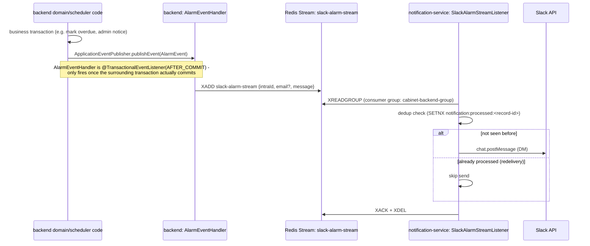

# Service Architecture

## Services and their single responsibility

| Service | Responsibility | Talks to |
|---|---|---|
| `backend` | Locker rental/return, auth, coin/store, calendar, admin, scheduling. Publishes domain events; never calls Slack directly. | MariaDB (JPA), Redis (cache, locks, stream producer), `ai` (REST), `notification-service` (indirectly, via Redis Stream) |
| `ai` | Classifies a return photo as empty/occupied. | nothing (stateless inference) |
| `notification-service` | Consumes the Slack alarm stream and sends the actual Slack DM. The only service allowed to call the Slack API. | Redis (stream consumer), Slack API |
| `nginx` | Reverse proxy / routing for the public-facing API and FE. | `backend` |
| `fe` | Web client. | `nginx` |

`backend` and `notification-service` do not call each other directly over REST — they are decoupled through Redis Streams. This was a deliberate choice over a synchronous REST call: a Slack outage or rate limit should never block a rental/return request, and the backend already used an async, transactional-outbox-like pattern (`AlarmEventHandler`) for this before the split.

## Why notification-service exists

Before this split, Slack alarm consumption (`SlackAlarmStreamListener` + `SlackBotService`) ran inside the same JVM as the rest of the backend. It has nothing to do with locker/rental logic, has its own external dependency (the Slack API) and its own failure mode, and can be deployed/restarted independently of the backend. Splitting it out is the "microservices backend" module for this project.

The **logtime-sync stream** (`LogtimeStreamListener`) was *not* moved — it directly touches domain services (`UserUseCase`, `ItemRepositoryPort`) and belongs with the rest of the backend's business logic. Only the Slack-specific consumer was extracted.

## Event flow: rental/return/overdue alarm -> Slack DM

### Producers of `AlarmEvent`

Both still live in the backend and are unchanged by the split:

- `LentScheduler` (overdue / imminent-return / auto-extension-disabled alarms) — publishes from inside `@Transactional` scheduled jobs.
- `AdminAlarmService.sendEmergencyNotice` (via `SlackAlarmAdapter`, which implements the `AlarmPort` domain port) — this method is now `@Transactional(readOnly = true)` specifically so the `AFTER_COMMIT` event listener actually fires (it previously called `SlackBotService` synchronously with no transaction boundary at all, which worked by accident; publishing-based delivery requires a real transaction to commit).

### Redis Stream record schema (`slack-alarm-stream`)

Written by `AlarmEventHandler` (backend), read by `SlackAlarmStreamListener` (notification-service):

| Field | Type | Required | Notes |
|---|---|---|---|
| `intraId` | string | yes | Used as the Slack DM target (looked up via `slack_users.csv` or the Slack `users.list` API) |
| `email` | string | no | Carried for completeness; not currently used by the consumer |
| `message` | string | yes | Final DM text, already formatted by the producer |

Consumer group: `cabinet-backend-group` (unchanged name, so any pending/unacked entries from before the split are still visible to the new service). Delivery semantics: at-least-once (standard Redis Stream consumer group behavior — a crash between `XREADGROUP` and `XACK` leaves the entry pending and it gets redelivered). The consumer deduplicates redeliveries using a `SETIFABSENT` guard key (`notification:processed:<stream-record-id>`, 24h TTL) before actually calling Slack, so a redelivered message is acknowledged/deleted but not re-sent.

## Hexagonal boundaries

The backend's existing ports/adapters structure is preserved: `AlarmPort` (domain port, `com.gyeongsan.cabinet.domain.alarm.port.out`) is still implemented by `SlackAlarmAdapter` (`adapter/out/external/slack`) — only the adapter's internals changed (it publishes an event instead of calling a service method directly). Domain code (`AdminAlarmService`) has zero knowledge that Slack delivery moved to another process.

notification-service is intentionally not structured as a hexagonal app — it is a thin, single-purpose consumer (read a stream, call one external API) where that structure would add indirection without a corresponding benefit.

## Logging (ELK)

| Source | Collection method | Why |
|---|---|---|
| `backend` | `logstash-logback-encoder`'s `LogstashTcpSocketAppender`, streaming JSON to `logstash:5000` | The app already runs in a JVM we fully control; a TCP appender is async/non-blocking (buffers and reconnects if Logstash is down, never blocks request handling) and avoids any file-sharing or Docker-daemon networking quirks. |
| `notification-service` | Same TCP appender, `service: "notification-service"` | Same reasoning, same mechanism. |
| `nginx` | `log_format json_combined` (in `backend/nginx/conf.d/default.conf`) writing to a shared `nginx_logs` volume, tailed by a Logstash `file` input | Docker's built-in logging drivers (`gelf`, `syslog`, etc.) run in the Docker **daemon's** network namespace, not the container's, so they cannot resolve compose service DNS names like `logstash` — only a host IP:port would work, which would mean publishing a port just for log shipping. File-tailing a shared volume avoids that entirely and needed no Dockerfile changes (the official nginx image already lets you point `access_log`/`error_log` at a custom path). |
| `ai` | **Not collected** | The service only uses bare `print()` / uvicorn's default stdout logger today, with no structured or file-based output. Collecting it would mean either mounting the host's Docker log directory into Logstash (fragile: tied to container IDs that change on every recreate) or adding real Python logging to `ai/` first. Left out of scope for this iteration rather than faked; the nginx file-tailing pattern above is the template to follow if/when this is picked up. |

Every structured log entry carries `service`, `level`, and (for backend requests) a per-request `traceId` set by `TraceIdFilter` and propagated through MDC — see `backend/src/main/java/com/gyeongsan/cabinet/common/logging/TraceIdFilter.java`.

**Retention/archiving**: an ILM policy (`app-logs-ilm-policy`, set up by `elk/setup/setup.sh`) rolls the write index over at 1 day/1GB and deletes indices older than `LOG_RETENTION_DAYS` (default 30). This project does **not** implement cold-storage snapshot archiving beyond that window — doing so would need a configured snapshot repository (e.g. object storage), which wasn't set up here. The 30-day delete-on-expiry policy is the only retention mechanism in place; treat "archiving" as a known gap, not a shipped feature.

**Security**: `xpack.security` is enabled on Elasticsearch with HTTP SSL disabled (internal-network-only, not required for a single-node dev-scale deployment). Three accounts exist: `elastic` (superuser, also used to log into Kibana), `kibana_system` (built-in, used only by Kibana to talk to ES), and `logstash_writer` (custom role, write-only access to `app-logs*` indices — Logstash never uses the superuser). Only Kibana's port (5601) is published to the host; Elasticsearch, Logstash's TCP/HTTP ports, and the nginx log volume are reachable only on the internal Docker network.
